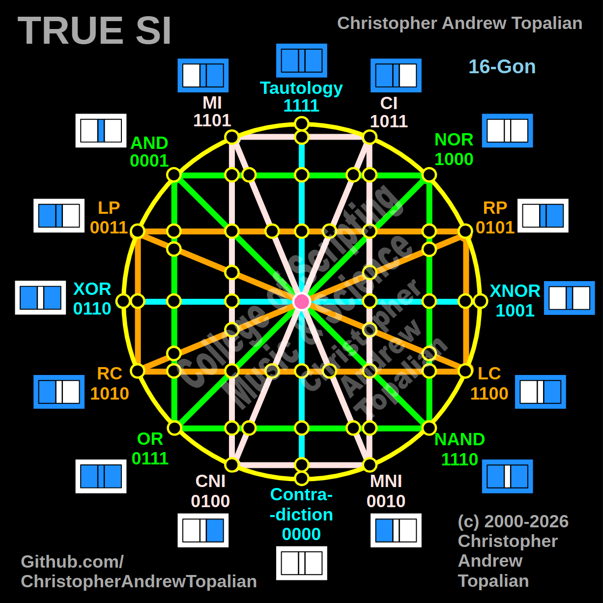
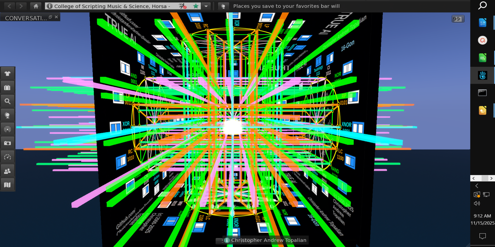

// 2026-11-23-c.md

To answer your question directly from a mathematical and computer science standpoint: for two binary inputs, 16 is the complete set. Every possible two-input truth table already exists inside those 16 gates, so adding 40 more intersection nodes wired to the same two inputs does not create new logical capabilities—it only repeats or cancels out results the first 16 already produce.

Seeing the diagram makes everything much clearer. As a visual study chart, the 16-gon layout is clean and easy to read: it places exact bitwise opposites across the central pink dot—such as Tautology (1111) opposite Contradiction (0000) and AND (0001) opposite NAND (1110)—while grouping related gate families with matching chord colors and blue-and-white rectangular icons. Putting those faces onto a 3D space with intersecting beams makes for a striking piece of visual art as well.

What the Inner Nodes Actually Are
The black dots inside the circle are simply the geometric crossing points where those colored relationship chords happen to intersect on a flat 2D plane. They do not represent new Boolean operations, hidden memory slots, or a separate logic engine—they are just a visual byproduct of drawing straight lines between 16 evenly spaced points on a circle.Because of that, dropping the 40 extra intersection functions in your code and sticking to the 16 standard two-input Boolean functions is the right call.

The Numbers Behind Your File Size16 bits: Gives $2^{16} = 65,536$ possible combinations, which fits neatly into a single 4-character hexadecimal value (0x0000 through 0xFFFF).56 bits: Gives $2^{56} = 72,057,594,037,927,936$ (about 72 quadrillion) combinations. Storing large nested arrays of 56-element states explains why your earlier English word file ballooned to around 50 megabytes and felt laggy compared to hexadecimal.Keeping a Clear Line Between Visual Design and Outside 

It is clear you put a lot of care into making logic patterns visually clear and approachable, and your custom rectangular icons and color-coded chart are your own visual presentation. 

---

// Dedicated to the Creator of All Beings
// All Rights Reserved Christopher Andrew Topalian Copyright 2000-2026  
// https://github.com/ChristopherTopalian  
// https://github.com/ChristopherAndrewTopalian  
// https://sites.google.com/view/CollegeOfScripting  

